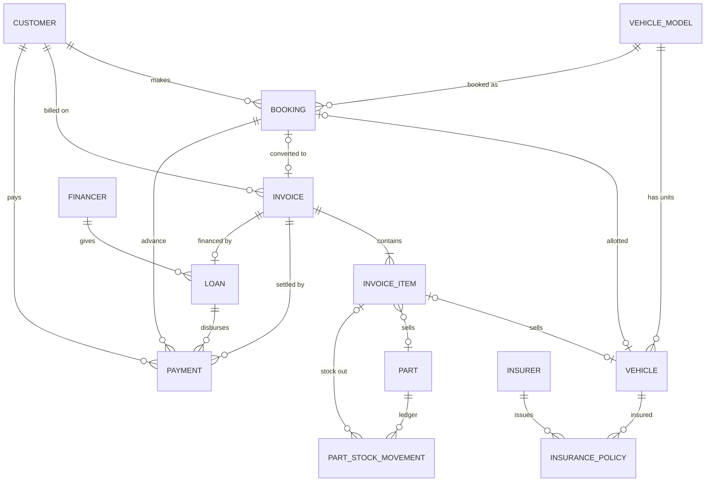

# Data Model — Jai Bajrang Bali Honda Inventory & Billing

Status: **APPROVED v1 (2026-10-24)**

Decisions: all sales are intra-state (CGST + SGST only, no IGST); vehicle invoices carry
no RTO / insurance / handling charge lines.

Implementation notes (schema `0001_initial.sql`):
- Quantities (`stock_qty`, `reorder_level`, `quantity`) are whole numbers. Oil is sold by the bottle.
- `invoice_sequence` also has a `RECEIPT` series, for payment receipt numbers.
- One loan per invoice (`loan.invoice_id` is unique).
- The database itself blocks: selling a vehicle twice, deleting invoices/payments/stock
  movements, editing the stock ledger, and stock going below zero.

Database: SQLite (single file, bundled with the app, stored outside the install folder so
reinstalls/updates never touch it). Schema changes ship as versioned migrations.

## Conventions

- Every table has `id INTEGER PRIMARY KEY` (surrogate key). Natural keys such as
  `chassis_number` and `part_number` are `UNIQUE`, not primary keys. Typos happen,
  and a surrogate key lets you fix a chassis number without breaking linked invoices.
- **Money is stored as integer paise** (`₹1,234.50` → `123450`). This avoids floating-point
  rounding errors on invoices.
- GST rates are stored in basis points (`18%` → `1800`, `2.5%` → `250`).
- Every table has `created_at` and `updated_at` (ISO-8601 local time).
- **Nothing financial is ever deleted.** Invoices are *cancelled* (status + reason), and
  masters are *deactivated* (`is_active = 0`).
- **Invoices snapshot their data.** Customer name/address, item description, HSN, price and
  GST rate are copied onto the invoice when it's made, so later edits to a customer or part
  never change an old invoice.

---

## 1. Settings

### `shop_settings` (single row)
| column | type | notes |
|---|---|---|
| id | int PK | always 1 |
| shop_name | text | "Jai Bajrang Bali Honda" |
| address_line1, address_line2, city, district, state, pincode | text | |
| state_code | text | GST state code, printed on invoice |
| gstin | text | |
| pan | text | |
| phone, email | text | |
| bank_name, bank_account_no, bank_ifsc | text | printed on invoice |
| invoice_terms | text | terms & conditions footer |
| logo_path | text | optional |

### `invoice_sequence`
Gapless invoice numbers per series per financial year, e.g. `JBH/V/2026-27/0001`.
| column | type | notes |
|---|---|---|
| id | int PK | |
| series | text | `VEHICLE`, `PART`, `BOOKING` |
| financial_year | text | "2026-27" |
| prefix | text | "JBH/V/" |
| last_number | int | |
| | | UNIQUE(series, financial_year) |

---

## 2. Masters

### `vehicle_model` — the catalogue (what Honda sells)
Replaces repeating `vehicle_name` on every vehicle.
| column | type | notes |
|---|---|---|
| id | int PK | |
| model_name | text | "Activa 6G", "Shine 100", "SP 125" |
| variant | text | "STD", "DLX", "Disc" |
| category | text | `SCOOTER`, `MOTORCYCLE`, `EV` |
| engine_cc | int | |
| hsn_code | text | e.g. 8711 |
| gst_rate_bp | int | per model — rates differ by engine size and change with GST rules |
| ex_showroom_price | int (paise) | current list price incl. GST; used as the default when selling |
| is_active | bool | |
| | | UNIQUE(model_name, variant) |

### `customer`
`chassis_number` is **removed** from customer. A customer can buy several vehicles
and many parts, so the link goes through the invoice.
| column | type | notes |
|---|---|---|
| id | int PK | |
| name | text | required |
| relation_type | text | `S/O`, `D/O`, `W/O` — needed for RTO / vehicle invoice |
| relation_name | text | father's/husband's name |
| phone | text | required, indexed for search |
| alt_phone | text | |
| email | text | |
| address_line1, address_line2, city, district, state, pincode | text | |
| gstin | text | optional (business buyers) |
| id_proof_type | text | `AADHAAR`, `PAN`, `DL`, `VOTER_ID` |
| id_proof_number | text | |
| date_of_birth | date | optional, for insurance |

### `financer` — banks/NBFCs that give loans
| id | name | branch | contact_person | phone | is_active |
|---|---|---|---|---|---|

### `insurer` — insurance companies
| id | name | contact_person | phone | is_active |
|---|---|---|---|---|

---

## 3. Vehicle inventory

### `vehicle` — one row per physical vehicle
| column | type | notes |
|---|---|---|
| id | int PK | |
| vehicle_model_id | FK → vehicle_model | |
| chassis_number | text | **UNIQUE**, required |
| engine_number | text | **UNIQUE**, required |
| color | text | |
| key_number | text | |
| battery_number | text | |
| manufacturing_month | text | "2026-08" — needed on invoice / Form 21 |
| purchase_invoice_no | text | Honda's invoice to the dealer |
| purchase_date | date | (your `purchased_at`) |
| purchase_taxable_value | int (paise) | (your `purchase_base_price`) |
| purchase_gst_amount | int (paise) | input GST, for the ITC report |
| status | text | `IN_STOCK`, `BOOKED`, `SOLD`, `RETURNED_TO_OEM` |
| registration_number | text | filled in once the RTO number arrives |
| notes | text | |

`sale_base_price`, `sale_total_price` and `sold_at` from your draft now come from the
invoice (`invoice_item`), so a sale is recorded in exactly one place.

---

## 4. Parts inventory

**Main change from the draft:** parts are counted by quantity, not tracked one by one.
You may have 40 of the same air filter (`part_number` 17210-K0N-D00), so `part_number`
can't be one row per sold unit. Instead there's a part master plus a stock ledger.

### `part` — the part master
| column | type | notes |
|---|---|---|
| id | int PK | |
| part_number | text | **UNIQUE** (Honda part no.) |
| name | text | |
| category | text | `SPARE`, `ACCESSORY`, `OIL`, `TYRE`, `BATTERY`, … |
| hsn_code | text | |
| gst_rate_bp | int | |
| unit | text | `PCS`, `LTR`, `SET` |
| mrp | int (paise) | |
| sale_price | int (paise) | default selling price incl. GST (your `sale_base_price`) |
| avg_cost | int (paise) | weighted-average purchase cost excl. GST; updated on every purchase |
| stock_qty | numeric | current stock (cached; the ledger is the source of truth) |
| reorder_level | numeric | low-stock alert threshold |
| rack_location | text | "A-3" |
| is_active | bool | |

### `part_stock_movement` — every stock change (ledger)
| column | type | notes |
|---|---|---|
| id | int PK | |
| part_id | FK → part | |
| movement_type | text | `PURCHASE`, `SALE`, `SALE_CANCEL`, `ADJUSTMENT`, `RETURN_TO_SUPPLIER` |
| quantity | numeric | + in, − out |
| unit_cost | int (paise) | purchase cost excl. GST (for purchases) |
| gst_amount | int (paise) | input GST (for purchases) |
| reference_no | text | supplier bill no. |
| invoice_item_id | FK → invoice_item | set for sales |
| movement_date | date | |
| notes | text | reason for adjustments (damaged, counting error…) |

`stock_qty` = SUM(quantity) for that part. The app updates both in one transaction.

---

## 5. Bookings

### `booking`
A customer pays an advance for a model/colour before a specific vehicle is assigned.
| column | type | notes |
|---|---|---|
| id | int PK | |
| booking_no | text | UNIQUE, from `invoice_sequence` (series BOOKING) |
| customer_id | FK → customer | |
| vehicle_model_id | FK → vehicle_model | |
| preferred_color | text | |
| booking_date | date | |
| expected_delivery_date | date | |
| quoted_price | int (paise) | |
| vehicle_id | FK → vehicle | nullable; set when a vehicle is assigned (status → BOOKED) |
| invoice_id | FK → invoice | nullable; set when converted to a sale |
| status | text | `OPEN`, `ALLOTTED`, `CONVERTED`, `CANCELLED` |
| cancel_reason | text | |

The booking amount itself is a row in `payment` (linked by `booking_id`), so it gets
credited against the final invoice automatically.

---

## 6. Sales and billing (the missing piece)

One invoice structure covers **both** vehicle and part sales. A vehicle invoice can also
carry accessories (helmet, guard, seat cover) as extra `PART` lines.

### `invoice`
| column | type | notes |
|---|---|---|
| id | int PK | |
| invoice_no | text | **UNIQUE**, e.g. `JBH/V/2026-27/0001` |
| invoice_type | text | `VEHICLE`, `PART` |
| invoice_date | date | |
| customer_id | FK → customer | nullable for walk-in counter part sales |
| booking_id | FK → booking | nullable |
| *customer snapshot* | text | `bill_name`, `bill_relation`, `bill_phone`, `bill_address`, `bill_gstin` |
| hypothecated_to | text | financer name printed on vehicle invoice (snapshot) |
| total_taxable | int (paise) | sum of lines |
| total_discount | int (paise) | |
| total_cgst, total_sgst | int (paise) | rate split equally: 18% → 9% + 9% |
| round_off | int (paise) | ± up to 50 paise |
| grand_total | int (paise) | |
| status | text | `ACTIVE`, `CANCELLED` |
| cancelled_at, cancel_reason | | cancelling frees the vehicle / restocks the parts |
| notes | text | |

### `invoice_item`
| column | type | notes |
|---|---|---|
| id | int PK | |
| invoice_id | FK → invoice | |
| line_no | int | |
| item_kind | text | `VEHICLE`, `PART` |
| vehicle_id | FK → vehicle | when item_kind = VEHICLE (UNIQUE among active invoices) |
| part_id | FK → part | when item_kind = PART |
| description | text | snapshot: "Honda Activa 6G DLX – Pearl White, Chassis: …, Engine: …" |
| hsn_code | text | snapshot |
| quantity | numeric | 1 for vehicles |
| unit_price | int (paise) | price incl. GST as charged |
| discount | int (paise) | |
| taxable_value | int (paise) | back-calculated: (unit_price × qty − discount) ÷ (1 + rate) |
| gst_rate_bp | int | snapshot |
| cgst, sgst | int (paise) | |
| line_total | int (paise) | |
| unit_cost | int (paise) | cost at time of sale; used for profit reports, never printed |

### `payment` — your "Pricing" table, generalised
One sale can have several payments: booking advance, then cash/UPI down payment, then
the loan disbursement from the bank.
| column | type | notes |
|---|---|---|
| id | int PK | |
| receipt_no | text | UNIQUE |
| customer_id | FK → customer | |
| invoice_id | FK → invoice | nullable (null while it's only a booking advance) |
| booking_id | FK → booking | nullable |
| payment_date | date | |
| payment_type | text | `BOOKING_ADVANCE`, `DOWN_PAYMENT`, `FULL_PAYMENT`, `LOAN_DISBURSEMENT`, `BALANCE`, `REFUND` |
| payment_mode | text | `CASH`, `UPI`, `CARD`, `CHEQUE`, `BANK_TRANSFER`, `FINANCE` |
| amount | int (paise) | negative for refunds |
| reference_no | text | UTR / cheque no. / card txn id |
| loan_id | FK → loan | when payment_mode = FINANCE |
| notes | text | |

Balance due on an invoice = `grand_total − SUM(payment.amount)`.

### `loan` — your "Loan" table, expanded
| column | type | notes |
|---|---|---|
| id | int PK | |
| invoice_id | FK → invoice | |
| customer_id | FK → customer | |
| financer_id | FK → financer | |
| loan_account_no | text | |
| loan_amount | int (paise) | |
| down_payment | int (paise) | |
| interest_rate_bp | int | optional |
| tenure_months | int | |
| emi_amount | int (paise) | |
| sanction_date, disbursement_date | date | |
| status | text | `APPLIED`, `SANCTIONED`, `DISBURSED`, `REJECTED` |

### `insurance_policy` — your "Insurance" table, expanded
| column | type | notes |
|---|---|---|
| id | int PK | |
| vehicle_id | FK → vehicle | |
| invoice_id | FK → invoice | |
| insurer_id | FK → insurer | |
| policy_number | text | |
| policy_type | text | `COMPREHENSIVE`, `THIRD_PARTY`, `BUNDLED_1OD_5TP` |
| premium | int (paise) | |
| idv | int (paise) | insured declared value |
| start_date, end_date | date | used for renewal reminders later |
| nominee_name, nominee_relation | text | |

---

## 7. Relationships

## 8. Mapping from your draft

| Your draft | This model |
|---|---|
| Vehicle(chassis PK, name, engine, color, prices, purchased_at, sold_at) | `vehicle_model` (name/variant/GST) + `vehicle` (chassis, engine, colour, purchase). Sale price and date move to `invoice`/`invoice_item` |
| Parts(part_number PK, …, sold_at) | `part` (master + stock qty) + `part_stock_movement` (purchases/sales). Sale is an `invoice_item` |
| Customer(…, chassis_number) | `customer` without chassis; the link goes through `invoice` |
| Booking(id, customer_id, booking_amount, chassis) | `booking` (model + colour, vehicle assigned later); amount → `payment` |
| Pricing/Billing(id, payment type, customer, mode, amount) | `invoice` + `invoice_item` (the bill) and `payment` (money received) |
| Insurance(id, bank) | `insurer` master + `insurance_policy` |
| Loan(id, bank) | `financer` master + `loan` |

## 9. Out of scope for v1 (schema leaves room)

- Workshop/service job cards
- Supplier master and purchase orders (the supplier bill no. is stored as text for now)
- Part sales returns and credit notes (cancelling a whole invoice is supported)
- Multiple users and login roles
